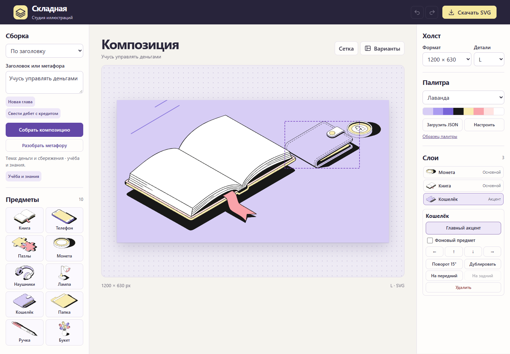
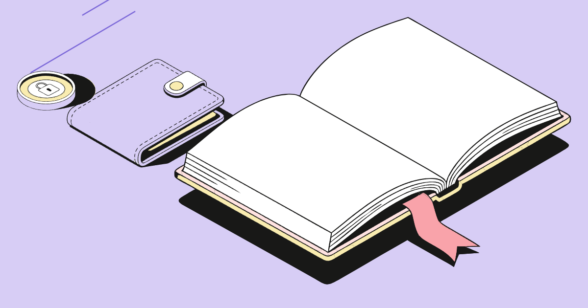
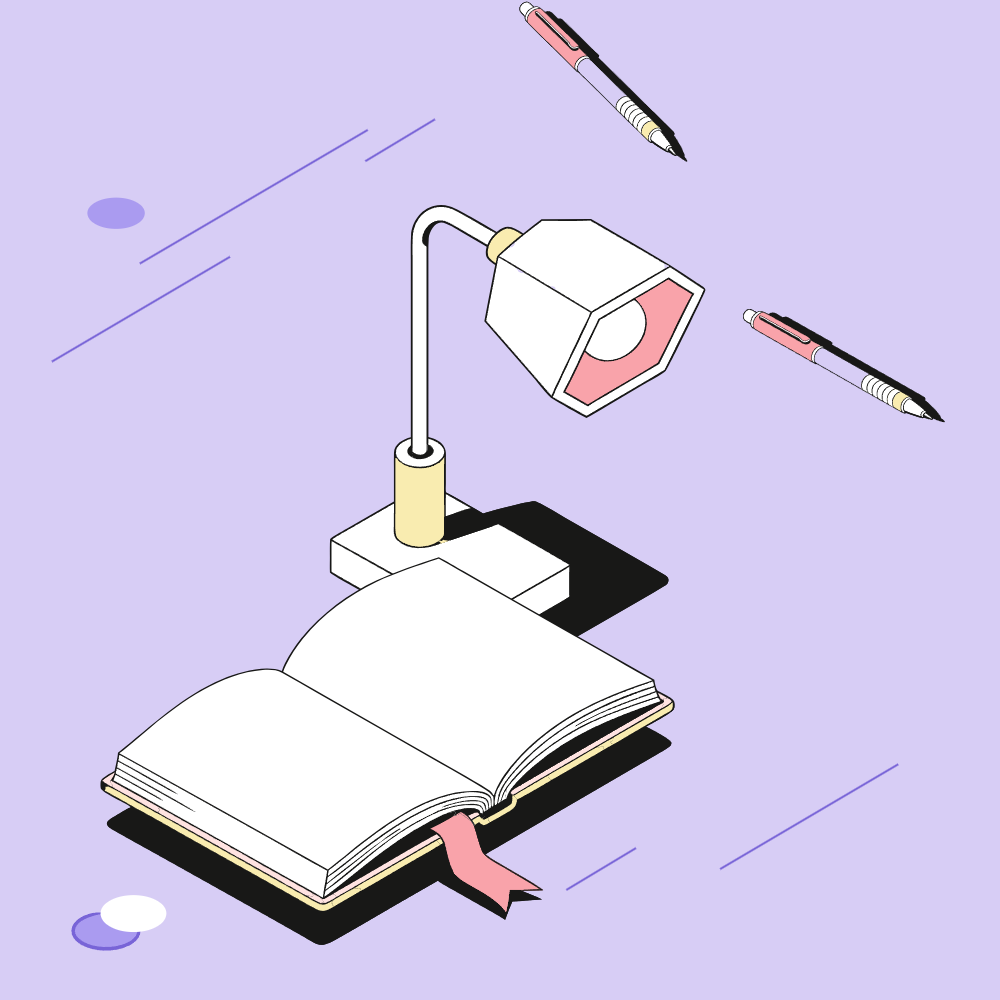
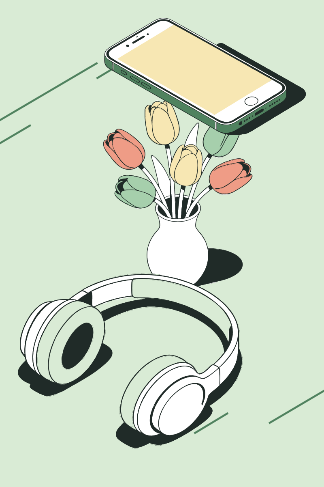

# Складная

Веб-студия для сборки векторных иллюстраций по заголовку, метафоре или списку предметов. Использует SVG-библиотеку из предоставленного тестового задания. Композицию можно править вручную и скачать в редактируемом SVG.

**[Открыть сервис](https://kzhigalov-dev.github.io/skladnaya-illustration-studio/)** · **[Короткая демонстрация](https://kzhigalov-dev.github.io/skladnaya-illustration-studio/demo.mp4)** · **[Скачать запускаемый проект](https://github.com/kzhigalov-dev/skladnaya-illustration-studio/archive/refs/heads/main.zip)**

[Материалы для сдачи одним текстом](SUBMISSION.txt) · [Подробный отчёт проверки](qa/REPORT.md) · [Композиции в Figma](https://www.figma.com/design/922i3xiPc2chUS8tlXow4R?node-id=4008-2)

[](https://kzhigalov-dev.github.io/skladnaya-illustration-studio/)

## Посмотреть за минуту

1. Откройте сервис и соберите сцену по заголовку «Учусь управлять деньгами».
2. Переключитесь на список: «Лампа, книга, две ручки». Проверьте повторы, L/S, форматы и варианты композиции.
3. Переместите предмет, поверните его, измените порядок слоёв и загрузите [свою палитру](palette.json).
4. Скачайте SVG и откройте его в Figma или векторном редакторе.

[Видео, 59,5 секунды](https://kzhigalov-dev.github.io/skladnaya-illustration-studio/demo.mp4) показывает фактическую работу: оба режима ввода, раскладку, ручную правку, палитру и скачивание SVG. Формат — H.264, 1440 × 900.

## Примеры композиций

| Деньги и учёба | Письменный стол | Весна в наушниках |
| --- | --- | --- |
|  |  |  |
| 1200 × 630 · L | 1000 × 1000 · L | 800 × 1200 · S |
| Заголовок «Учусь управлять деньгами» | Список с повторами, ручной сдвиг и поворот | Вертикальный формат и пользовательская палитра |
| [Редактируемый SVG](examples/01-learning-budget.svg) | [Редактируемый SVG](examples/02-desk.svg) | [Редактируемый SVG](examples/03-spring-audio.svg) |

Все три файла содержат векторные пути и отдельные группы предметов. Их структура проверена, результаты импортированы в Figma.

## Возможности

- 10 предметов, у каждого — L/S и цветная/фоновая версия: всего 40 исходных вариантов.
- Три исходные палитры: Лаванда, Абрикос, Аквамарин. Импорт JSON и настройка восьми цветовых ролей с предпросмотром.
- Форматы 1200 × 630, 1000 × 1000 и 800 × 1200; три варианта композиции.
- Перемещение, поворот, дублирование, удаление, порядок слоёв и выбор главного акцента.
- Отмена и повтор правок, восстановление черновика при доступном хранилище браузера.
- Направляющие Golden Canon / Van de Graaf. Они отображаются в редакторе и исключаются из экспорта.
- Дополнительный анализ сложных метафор моделью Qwen3 8B на устройстве с предпросмотром трактовки.

## Архитектура SVG

**Хранение.** Исходные SVG находятся в `assets.js` и `flowers.js` в виде строк, сгруппированных по ключу предмета и варианту. `library.js` связывает их с идентификаторами исходных узлов Figma. Палитры задают восемь цветовых ролей. Контуры исходных элементов сохраняются.

**Извлечение.** При подготовке проекта элементы L/S и цветные/фоновые версии экспортированы из предоставленного Figma-файла через MCP-интеграцию Claude Talk to Figma. Во время запуска `library.js` разбирает строки через `DOMParser`, сохраняет DOM-шаблон, `viewBox`, габариты и соответствие исходных цветов ролям. Повторный доступ к Figma для работы приложения не требуется.

**Переиспользование.** Для каждого слоя `document.importNode` создаёт копию шаблона. Идентификаторы получают уникальный префикс; ссылки `url(#…)` и `href` обновляются вместе с ними. Цвета `fill`, `stroke` и градиентов заменяются по ролям. Равномерное масштабирование и трансформации размещают предмет с сохранением его пропорций и общего относительного масштаба сцены. Фоновые элементы используют только фоновые цветовые роли.

**Сборка и экспорт.** `planner.js` преобразует заголовок или список в предметы, количества и роли с учётом отрицаний. `composition.js` подбирает размещение по опорным точкам канона, измеренным силуэтам и перекрытиям; `art-metrics.js` хранит метрики сорока вариантов. `studio.js` управляет сценой и ручными правками. Предпросмотр и экспорт используют один построитель SVG, поэтому в скачанном файле сохраняются пути и группы предметов, а внутренние ссылки остаются согласованными.

**Дополнительная модель.** `semantic-protocol.js` задаёт закрытый каталог и схему ответа. `local-intelligence.js` выбирает доступный движок и управляет отменой. `intelligence-worker.js` выполняет WebGPU-инференс через WebLLM; `server.cjs` обслуживает локальное приложение и обращается к Ollama.

## AI-инструменты

| Инструмент | Использование |
| --- | --- |
| **OpenAI Codex** | Разработка кода, алгоритма композиции, тестов и документации; работа с Figma через подключённые инструменты. |
| **Qwen3 8B** | Дополнительный смысловой анализ заголовка в самом продукте. Выполняется на устройстве через WebLLM/WebGPU или Ollama. |
| **Claude Talk to Figma** | MCP-интеграция для чтения задания, экспорта исходных SVG и контрольного импорта результатов. Это связующий инструмент, а не отдельная использованная языковая модель. |
| **Qwen3 4B Instruct** | Экспериментальная проверка качества смыслового анализа во время разработки; в продукте используется 8B. |
| **Multilingual E5-small** | Исследовательский эксперимент с поиском похожих сюжетов; в финальный продукт не включён. Результаты описаны в отчёте. |

Векторная библиотека получена из [предоставленного задания](https://www.figma.com/design/4MCFttsSoP7hgQh29zq5G3?node-id=36-12453). Размещение и перекраска выполняются локальным алгоритмом. Автоматические браузерные проверки проведены с Playwright.

## Локальный запуск

Для базового редактора распакуйте проект и откройте `index.html` в Chrome или Edge. Установка, сборка, API-ключи и сеть для этого режима не требуются.

Для запуска через HTTP из папки проекта:

```sh
node server.cjs
```

Откройте <http://127.0.0.1:8183/>. Сервер проверен с Node.js 24.14.1. Альтернативный статический сервер:

```sh
python -m http.server 8182 --bind 127.0.0.1
```

### Анализ моделью

На **GitHub Pages** дополнительный анализ работает в браузере через WebGPU. Нужны совместимый Chrome/Edge, аппаратное ускорение и достаточные ресурсы видеоустройства. Первая загрузка Qwen3 8B — около **5 ГБ**, она может занять несколько минут. Веса сохраняются в IndexedDB для следующих запусков того же адреса. Интернет нужен для загрузки WebLLM и весов; сам заголовок обрабатывается на устройстве. Редактор доступен независимо от загрузки модели.

Для **локального режима Ollama** запустите установленную Ollama, загрузите модель и откройте приложение через Node-сервер:

```sh
ollama pull qwen3:8b
node server.cjs
```

Откройте <http://127.0.0.1:8183/>. Модель обнаруживается автоматически. На статическом GitHub Pages Node-сервер и локальная Ollama не запускаются.

В обоих вариантах результат анализа сначала показывается пользователю. Перед сборкой проверьте трактовку; закрытие диалога отменяет работу. Веса моделей в репозиторий не включены.

## Проверка качества

```sh
node --test composition.test.cjs qa/exclusions.test.cjs qa/analysis-races.test.cjs qa/semantic-protocol.test.cjs
node qa/benchmark.cjs --final --gate
```

Первый запуск проверяет геометрию, отрицания, отмену анализа и схему ответа: **28/28** тестов. Второй требует **34/34** подходящих сюжетов и **6/6** корректных отказов на исходной финальной серии. Четыре исходные серии использовались при настройке локальных правил.

Дополнительная модель в Ollama дала **33/34 и 6/6** на диагностической серии и **23/24 и 6/6** на дополнительном внутреннем наборе. Эти числа относятся к зафиксированным рубрикам; косвенные метафоры могут требовать уточнения. Внешнего слепого ревью не проводилось. Браузерная модель использует другую квантизацию того же семейства; полный набор измерен в Ollama.

Браузерный сценарий повторяется командой `python verify.py`. Для него нужны Python, Playwright, Pillow и установленный Chrome либо `CHROME_PATH` с путём к браузеру. Проверены Chrome и Edge, ручные правки, история, палитры, смена формата, узкий экран и векторный экспорт.

[Подробный отчёт и команды воспроизведения](qa/REPORT.md) · [Контактный лист 36 композиций](qa/canon-grid.png)

## Публикация

Репозиторий: [kzhigalov-dev/skladnaya-illustration-studio](https://github.com/kzhigalov-dev/skladnaya-illustration-studio).

GitHub Pages публикует корень ветки `main`. Файл `.nojekyll` отключает обработку Jekyll; HTML, SVG, JavaScript, видео и примеры раздаются как статические файлы. Для обновления сервиса достаточно отправить изменения в `main`.

Справочные материалы: [геометрия канона](https://archive.bridgesmathart.org/2012/bridges2012-417.pdf), [WebLLM](https://github.com/mlc-ai/web-llm), [браузерная модель](https://huggingface.co/mlc-ai/Qwen3-8B-q4f16_1-MLC).
